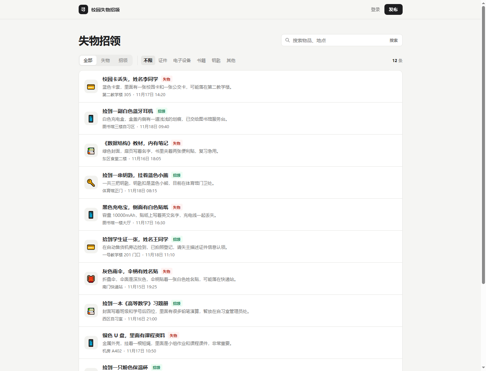

# 校园失物招领平台

一个面向校园的失物招领信息平台：发布失物或招领信息，按类型、分类和关键词快速查找。



当前进度：**第 2 周 Vue 3 前端原型**。已完成从原生 HTML/CSS/JS 到 Vue 3 + Vite + Vue Router 的迁移，下一阶段接入 Express + MySQL。

## 设计原则

- 单一目标：找到信息，或发布信息。
- 布局优先：用结构和层级表达用法，不依赖说明文案。
- 结构稳定：关键控件保留稳定 id、`data-*` 属性和可访问名称。
- 实现简单：Vue 3 + Vue Router，状态集中在轻量 store 中。
- 渐进演进：第 1 周原生版本归档在 `prototype/`，第 3 周添加 `server/`。

## 技术栈

| 层次 | 技术 |
| --- | --- |
| 前端框架 | Vue 3 |
| 构建工具 | Vite 6 |
| 路由 | Vue Router 4 |
| 样式 | 原生 CSS |
| 数据 | 本地 mock store |
| 后端 | Express + MySQL（第 3 周） |

## 已实现功能

- 首页信息列表、关键词搜索、类型筛选、分类筛选。
- 信息详情页。
- 发布表单：必填校验、图片预览。
- 登录状态与路由守卫（mock）。
- 管理员列表与删除操作（mock）。
- 响应式布局。

## 本地运行

安装依赖：

```bash
npm install
```

如果 `npm` 或 `node` 不在 PATH 中，先在当前 cmd 窗口执行：

```bash
set PATH=D:\ruanjian\nodejs;%PATH%
```

也可以直接使用本机 npm 路径：

```bash
D:\ruanjian\nodejs\npm.cmd install
```

启动开发服务器：

```bash
npm run dev
```

访问 <http://127.0.0.1:5173>。

构建生产版本：

```bash
npm run build
```

## 页面

| 路径 | 页面 | 说明 |
| --- | --- | --- |
| `/` | 首页 | 搜索、筛选、信息列表 |
| `/items/:id` | 详情 | 单条信息详情 |
| `/publish` | 发布 | 需要登录，表单校验 |
| `/login` | 登录 | mock 登录 |
| `/admin` | 管理 | 需要管理员权限，可删除 |

演示登录：

- 普通用户：任意用户名 + 任意密码。
- 管理员：用户名 `admin` + 任意密码。

## 项目结构

```text
campus-lost-found/
├── docs/
│   ├── database.md          # 数据库设计草稿
│   └── preview.png          # 界面截图
├── prototype/               # 第 1 周原生版本，已归档
├── src/
│   ├── components/          # Header、搜索、筛选、列表行
│   ├── data/                # 种子数据与分类映射
│   ├── router/              # 路由与登录守卫
│   ├── stores/              # 信息 store、登录 store
│   ├── styles/              # 全局样式
│   ├── views/               # 首页、详情、发布、登录、管理
│   ├── App.vue
│   └── main.js
├── index.html
├── package.json
└── vite.config.js
```

## 当前限制

- 信息数据保存在内存中，刷新页面后恢复为 12 条种子数据。
- 登录是 mock，不连接真实账号系统。
- 图片使用 Data URL 预览，第 4 周改为后端上传。
- 发布和管理员删除暂不写入数据库。

这些限制会在第 3～5 周逐步替换为真实 API。

## 后续计划

| 周次 | 目标 |
| --- | --- |
| 第 3 周 | Express + MySQL + 注册登录 |
| 第 4 周 | 信息 CRUD、搜索、图片上传 |
| 第 5 周 | 前后端联调，MVP 跑通 |
| 第 6～7 周 | 单元、接口、E2E 测试与 CI |
| 第 8～10 周 | Docker Compose、云服务器、Nginx、HTTPS |
| 第 11～12 周 | 打磨、文档、演示视频与求职材料 |
